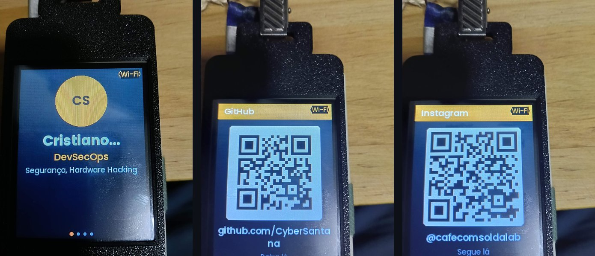
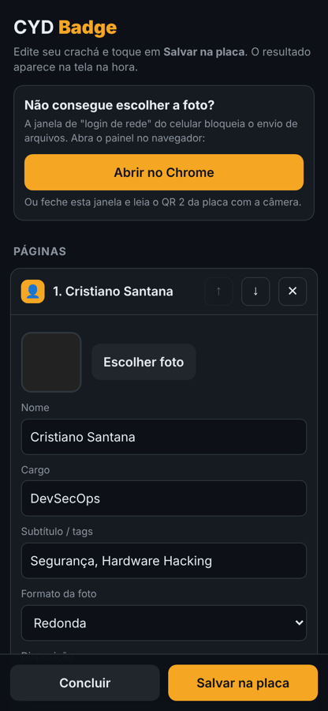
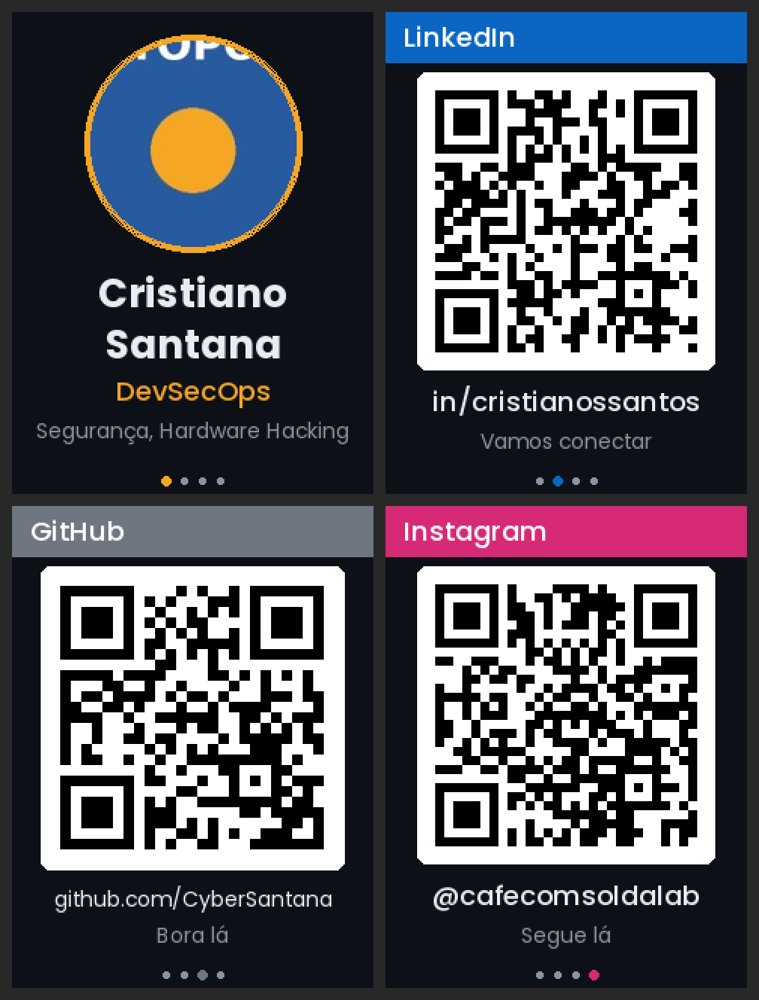
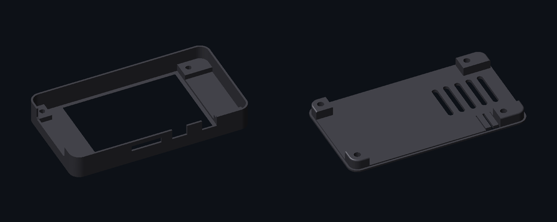

# ☕ CYD Badge

**Crachá digital para a Cheap Yellow Display (ESP32-2432S028)**, configurado inteiro pelo celular.
Foto, nome, cargo e páginas com QR code para LinkedIn, Instagram, GitHub, WhatsApp, Wi-Fi de convidados e contato. Roda pelo [Launcher](https://github.com/bmorcelli/Launcher), lado a lado com Bruce e Marauder.

Um projeto [Café com Solda](https://instagram.com/cafecomsoldalab) ☕🔧



## Destaques

- **Configuração pelo celular:** a placa cria uma rede Wi-Fi e mostra QR codes na tela. Você conecta, abre o painel e edita tudo. Sem computador, sem editar JSON.
- **Foto com recorte:** escolha da galeria, arraste e dê zoom para enquadrar. O celular redimensiona antes de enviar.
- **Páginas prontas:** LinkedIn, Instagram, GitHub, X, YouTube, TikTok, WhatsApp, site, contato (salva direto na agenda), Wi-Fi, texto e imagem. Nas redes sociais basta digitar o usuário.
- **Retrato ou paisagem**, com layout que se adapta e textos com acento (fonte Poppins embutida).
- **Case impresso em 3D** incluído neste repositório.
- **Seguro por padrão:** o Wi-Fi só liga com acesso físico à placa, usa senha nova a cada vez e desliga sozinho depois de 15 minutos sem uso.

<p align="center">
  
  &nbsp;&nbsp;
  
</p>

## O que você precisa

| Item | Observação |
|---|---|
| **CYD ESP32-2432S028 (2,8")** | [Link do AliExpress](https://pt.aliexpress.com/item/1005007774435209.html). Funciona nas versões de 1 e 2 portas USB |
| **Cartão microSD** | Qualquer tamanho, formatado em FAT32 |
| **Case 3D** (opcional) | STL na pasta [`hardware/`](hardware/) |
| **Clipe ou cordão de crachá** | Para pendurar |
| **Launcher** instalado na placa | [bmorcelli/Launcher](https://github.com/bmorcelli/Launcher) (opcional, veja abaixo) |



## Instalação

1. Baixe os binários na página de [**Releases**](../../releases).
2. Escolha o arquivo certo para a sua placa:

   | Arquivo | Quando usar |
   |---|---|
   | `cyd-badge-cyd-launcher.bin` | Instalar pelo Launcher. **Comece por este**, serve para a maioria das placas, inclusive muitas de 2 USB |
   | `cyd-badge-cyd2usb-launcher.bin` | Se o de cima deixar a tela toda branca (placas com display ST7789) |
   | `*-full.bin` | Gravar a placa inteira pelo computador, sem Launcher. **Apaga o Launcher** |

3. **Pelo Launcher:** copie o `.bin` para o cartão SD, coloque o cartão na placa e instale pelo menu **SD**.
   **Sem Launcher:** grave o `*-full.bin` no endereço `0x0` com o [ESP Web Tools](https://web.esphome.io/) ou com o esptool:
   ```bash
   esptool.py --chip esp32 write_flash 0x0 cyd-badge-cyd-full.bin
   ```

## Primeiro uso

1. Ligue a placa com um cartão SD (pode estar vazio). Ela cria a pasta `/badge` sozinha e abre o **modo configuração**.
2. **QR 1:** aponte a câmera do celular para conectar no Wi-Fi da placa (`CYD-Badge-XXXX`, senha na tela).
3. **QR 2:** abre o painel em `http://192.168.4.1` no navegador.
4. Preencha seus dados, escolha a foto, adicione as páginas e toque em **Salvar na placa**. A tela atualiza na hora.
5. Toque em **Concluir** para desligar o Wi-Fi.

Para editar depois, **segure o dedo na tela por 3 segundos**.

> Se o celular abrir uma janelinha de "login de rede", feche e abra o painel pelo QR 2, ou use o botão **Abrir no Chrome** que aparece no painel. Essa janela bloqueia o envio de fotos.

## Controles

| Ação | Resultado |
|---|---|
| Tocar à direita / deslizar para a esquerda | Próxima página |
| Tocar no terço esquerdo / deslizar para a direita | Página anterior |
| Segurar o dedo 1 a 3 s e soltar | Pausa ou retoma o slideshow |
| **Segurar o dedo 3 s** | **Modo configuração** |
| Botão BOOT (clique) | Próxima página |
| Botão BOOT (segurar ~1 s) | Alterna o brilho |
| Botão BOOT (segurar 3 s) | Entra ou sai do modo configuração |

Para voltar ao Launcher, reinicie a placa e toque na tela durante o boot.

## Problemas comuns

| Sintoma | Solução |
|---|---|
| Tela toda branca | Controlador de display diferente: troque entre o binário `cyd` e o `cyd2usb` |
| Cores trocadas (fundo claro, laranja azulado) | Painel → Aparência → **Corrigir cores invertidas** |
| Imagem de lado | Painel → Aparência → **Orientação da tela** |
| Tocar à direita volta a página | Painel → Aparência → **Inverter lado do toque** |
| Não consigo escolher a foto | Abra o painel no Chrome ou Safari, não na janela de login de rede |

## Para desenvolvedores

```bash
git clone https://github.com/SEU-USUARIO/cyd-badge.git
cd cyd-badge
pio run -e cyd                  # CYD com ILI9341
pio run -e cyd2usb              # CYD com ST7789
pio run -e cyd -t upload        # grava direto via USB (substitui o Launcher)
```

- Plataforma [pioarduino](https://github.com/pioarduino/platform-espressif32) (Arduino core 3.3), partição `huge_app`
- O painel web fica em [`src/web_ui.h`](src/web_ui.h) e é servido pela própria placa
- Formato completo do `config.json`: [`docs/CONFIG.md`](docs/CONFIG.md)
- Ferramentas em [`tools/`](tools/): pré-visualização das páginas no PC, preparo de imagens e gerador de fontes `.vlw`
- O GitHub Actions compila os binários a cada push e publica uma release quando você cria uma tag `v*`

### Pinos da CYD

| Função | Pinos |
|---|---|
| Display (HSPI) | SCLK 14, MOSI 13, MISO 12, DC 2, CS 15, BL 21 |
| Touch XPT2046 (bit-bang) | CLK 25, MOSI 32, MISO 39, CS 33, IRQ 36 |
| SD (VSPI) | SCK 18, MISO 19, MOSI 23, CS 5 |
| LED RGB (ativo em nível baixo) | R 4, G 16, B 17 |
| Botão BOOT | GPIO 0 |

O touch é lido por bit-bang para deixar o VSPI livre para o cartão SD.

## Créditos

- [LovyanGFX](https://github.com/lovyan03/LovyanGFX), gráficos, JPEG e QR code
- [ArduinoJson](https://arduinojson.org/)
- [Launcher](https://github.com/bmorcelli/Launcher) de bmorcelli
- Fonte [Poppins](https://github.com/itfoundry/Poppins) (SIL Open Font License, veja [`licenses/`](licenses/))

## Licença

- Código: [MIT](LICENSE)
- Case 3D: [CC BY-NC-SA 4.0](hardware/README.md#licença)
- Fonte Poppins: [SIL OFL 1.1](licenses/Poppins-OFL.txt)
