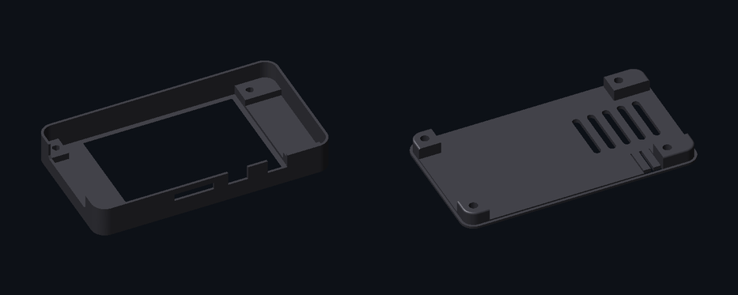

# Case do CYD Badge

Case impresso em 3D para a CYD (ESP32-2432S028), pensado para usar como crachá na vertical.

| Arquivo | Peças | Medidas |
|---|---|---|
| `cyd-case-cafecomsolda.stl` | moldura frontal e tampa traseira (no mesmo arquivo) | 95 × 107,5 × 12,5 mm (as duas peças lado a lado) |

## Impressão

<!-- Preencha com as configuracoes que voce usou -->
- Material: 
- Altura de camada: 
- Preenchimento: 
- Suporte: 
- Parafusos: 

## Licença

O modelo 3D está sob [CC BY-NC-SA 4.0](https://creativecommons.org/licenses/by-nc-sa/4.0/deed.pt_BR): pode imprimir, modificar e compartilhar dando os créditos, sem uso comercial e mantendo a mesma licença.
